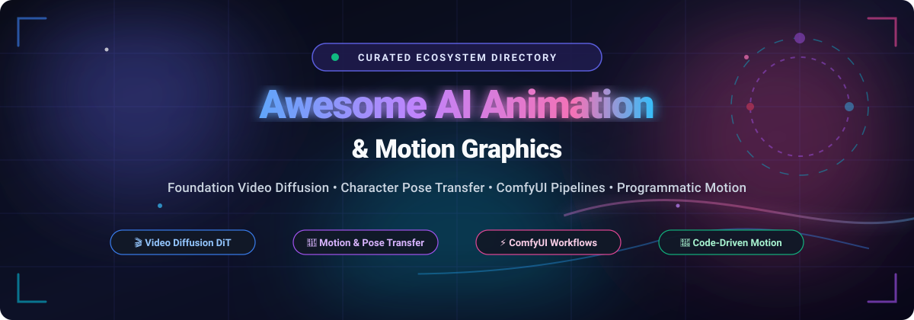

# 🎬 Awesome-AI-Animation-Motion-Graphics

 

 
 

**A comprehensive, curated collection of top SaaS platforms and open-source models for AI video generation, character motion transfer, ComfyUI animation workflows, and programmatic motion graphics.**

[🌟 Explore SaaS](#-saashosted-platforms) • [💻 Open-Source Repos](#-open-source-github-projects) • [📊 Sector Overview](#-sector-overview--market-dynamics) • [🤝 Support &amp; Community](#-support--community) • [✨ Contributing](#-how-to-contribute)

---

## 📌 Introduction &amp; Ecosystem Scope

The **AI Animation and Motion Graphics** ecosystem has experienced massive breakthroughs with the introduction of Diffusion Transformers (DiTs), autoregressive video generation architectures, explicit 3D Gaussian/pose retargeting, and code-based motion rendering frameworks. 

This curated directory serves as an index for:
- 🚀 **Cloud SaaS Engines**: Production-ready tools for text-to-video, stylized video-to-video, and character choreography.
- 🧬 **Local Open-Source Foundation Models**: State-of-the-art weights (DiT, VAE, U-Net) for local GPU generation (RTX 3090/4090 to multi-H100 clusters).
- 🎭 **Character Animation &amp; Motion Transfer**: Tools enabling pose retargeting, facial performance capture, and anime keyframe inbetweening.
- 🛠️ **ComfyUI Node Ecosystems**: Advanced node suites for frame interpolation, latent scheduling, context windows, and audio syncing.
- 📐 **Programmatic &amp; Vector Motion Design**: Code-first frameworks (React, Canvas, Python) for reproducible, mathematical, and data-driven animations.

---

## 📊 Sector Overview &amp; Market Dynamics

The global **AI Video and Generative AI Animation market** is projected to grow from **~$5.5 billion in 2026** to over **$40 billion by the early 2030s** at an astounding Compound Annual Growth Rate (CAGR) exceeding **33%**. 

The sector exhibits **moderate-to-high fragmentation**, defined by dynamic competition across multiple layers of the stack rather than a single winner-take-all monopoly:
- **Foundation Layer vs. Workflow Layer**: High-compute foundation model labs (Kuaishou Kling, Runway, Luma) compete vigorously with nimble application workflows (HeyGen, DomoAI, Viggle) that capture niche vertical workflows like marketing avatars, stylized anime transforms, and meme choreography.
- **Proprietary vs. Open-Source Pressure**: Rapid open-weight innovations (such as Alibaba's Wan2.1, Tencent's HunyuanVideo, Lightricks' LTX-Video, and Kwai's LivePortrait) continuously commoditize raw generative capabilities, pushing commercial SaaS providers to differentiate through fine-grained timeline controls, multi-track rendering, lip-sync fidelity, and studio-grade consistency.

---

## 🚀 SaaS/Hosted Platforms

The table below lists top hosted platforms for generative video and character animation, sorted by company valuation / scale (descending):

| Platform | Category &amp; Core Capability | Valuation / Revenue Scale | Starting Tier Pricing | Free Tier / Trial Limit |
| :--- | :--- | :--- | :--- | :--- |
| **[Kling AI](https://klingai.com)** | High-resolution generative video, 1080p long-form synthesis, motion brush &amp; lip-sync | **$18B Valuation** (Spun-out unit of Kuaishou, ~$500M ARR run-rate) | **$8.80/month** (Standard plan, 660 credits/mo) | **66 credits/month** (Free recurring monthly login bonus; 720p with watermark) |
| **[Leonardo.Ai](https://leonardo.ai)** | Generative visual suite, concept art motion, camera motion strength controls | **$5B+ Scale** (Acquired by Canva valued at $26B–$32B; 19M+ users) | **$12.00/month** (Essential plan, 8,500 fast tokens/mo) | **150 fast tokens/day** (Free recurring daily refresh; public feed exports) |
| **[Runway](https://runwayml.com)** | Gen-3 Alpha / Gen-4 AI filmmaking suite, Motion Brush, Act-One performance capture | **$5.3B Valuation** (Series E funded; ~$200M ARR) | **$15.00/month** ($12/mo billed annually; 625 credits/mo) | **125 credits one-time** (Permanent free trial grant; 5GB storage, watermarked) |
| **[Luma Dream Machine](https://lumalabs.ai)** | Physical coherence video generation, camera motion controls, high-speed rendering | **$4.0B Valuation** (Series C funded; ~$50M ARR run-rate) | **$9.99/month** (Lite plan, non-commercial testing) | **~80 credits/day** (Free daily refresh; personal use with watermark) |
| **[HeyGen](https://hedra.com)** | Studio-grade expressive avatar animation, talking avatars, voice &amp; audio sync | **$500M Valuation** (Series B funded; $200M+ ARR) | **$29.00/month** ($24/mo billed annually; 600 credits/mo) | **3 free videos/month** (1-minute max per video, watermarked exports) |
| **[Pika](https://pika.art)** | Creative motion platform, Pikaffects, region modification inpainting, lip-sync | **$470M–$700M Valuation** (Series B funded; ~$15M–$65M ARR) | **$10.00/month** ($8/mo billed annually; Starter plan) | **0 monthly credits** (Free account access; requires standalone credit pack top-ups) |
| **[Viggle AI](https://viggle.ai)** | Controllable character motion transfer via JST-1 3D physics model, webcam swaps | **$100M+ Estimated Valuation** ($19M Series A backed by a16z) | **$9.99/month** ($7.99/mo billed annually; Pro plan, 80 credits/mo) | **5 free video generations/day** (Watermarked, source video capped at 1 minute) |
| **[Kaiber](https://kaiber.ai)** | Audio-reactive animation, Beat Sync music video generation, canvas transformations | **$20M–$40M Estimated Valuation** (Seed-backed by EQT; ~$2.6M ARR) | **$10.00/month** (Starter plan, 500 credits/mo) | **5-day trial for $5** (Introductory trial with credit allotment; no free plan) |
| **[Haiper](https://haiper.ai)** | Perceptual foundation-model video creation, video repainting, motion templates | **$20M–$40M Estimated Valuation** ($19.2M Seed/Series A; ~$2M ARR) | **$9.99/month** (Explorer/Standard subscription) | **~10 generations/day** (Free tier daily refresh; 720p max, non-commercial) |
| **[DomoAI](https://domoai.app)** | Video-to-video restyling, live-action to anime/3D cartoon/comic motion conversion | **Bootstrapped / Private Scale** (High-growth creative community tool) | **$9.99/month** ($6.99/mo billed annually; Basic plan, 500 credits/mo) | **15 trial credits one-time** (Initial test grant upon signup) |

---

## 💻 Open-Source GitHub Projects

The table below catalogs open-source repositories across foundation video generation, character retargeting, ComfyUI nodes, programmatic motion tools, and frame interpolation, sorted by GitHub stargazers (descending):

| Project | GitHub_Stars | Primary Domain / Focus | Key Features |
| :--- | :--- | :--- | :--- |
| **[Remotion](https://github.com/remotion-dev/remotion)** |  | Programmatic Motion Graphics | Create frame-accurate MP4 animations and videos programmatically using React, TypeScript, CSS, WebGL, and SVG canvas. |
| **[Manim](https://github.com/ManimCommunity/manim)** |  | Mathematical &amp; Vector Animation | Community-maintained Python animation engine for algorithmic vector motion graphics, educational explainers, and math graphics. |
| **[Generative Models (SVD)](https://github.com/Stability-AI/generative-models)** |  | Foundation Video Diffusion | Stability AI's official codebase housing Stable Video Diffusion (`SVD` / `SVD-XT`) for high-resolution image-to-video generation. |
| **[Blender](https://github.com/blender/blender)** |  | 2D/3D Animation &amp; Compositing | Industry-standard open-source 3D creation suite used widely for hybrid AI keyframing, Grease Pencil 2D animation, and neural rendering. |
| **[SAM 2 (Segment Anything 2)](https://github.com/facebookresearch/sam2)** |  | Video Segmentation &amp; Rotoscoping | Meta's foundation model for promptable real-time visual mask extraction and rotoscoping across video sequences for VFX compositing. |
| **[Motion Canvas](https://github.com/motion-canvas/motion-canvas)** |  | Programmatic Motion Design | TypeScript vector motion graphics library paired with an interactive real-time browser timeline preview for coding procedural animations. |
| **[LivePortrait](https://github.com/KlingAIResearch/LivePortrait)** |  | Portrait &amp; Character Animation | Real-time portrait animation framework offering controllable stitching and retargeting for expressive eyes, lip movements, and head poses. |
| **[Wan2.1](https://github.com/Wan-Video/Wan2.1)** |  | Foundation Video Diffusion | Alibaba's flagship open-source (`Apache-2.0`) video foundation DiT supporting 480p/720p/1080p text-to-video and image-to-video generation. |
| **[FramePack](https://github.com/lllyasviel/FramePack)** |  | Autoregressive Video Diffusion | Memory-efficient video generation system by lllyasviel capable of rendering smooth, long-horizon video clips on 6GB–12GB consumer GPUs. |
| **[CogVideoX](https://github.com/zai-org/CogVideo)** |  | Foundation Video Diffusion | Tsinghua/Zhipu AI's open-source 3D causal VAE Diffusion Transformer family supporting smooth text-to-video and image-to-video generation. |
| **[HunyuanVideo](https://github.com/Tencent-Hunyuan/HunyuanVideo)** |  | Cinema Foundation DiT | Tencent's cinematic-grade open-source video foundation model featuring physics coherence, 1080p generation, and native ComfyUI integration. |
| **[AnimateDiff](https://github.com/guoyww/AnimateDiff)** |  | Motion Modules &amp; Diffusion | Landmark motion-module architecture that animates personalized Stable Diffusion checkpoints with camera motion control (`MotionLoRA`). |
| **[LTX-Video](https://github.com/Lightricks/LTX-Video)** |  | Real-Time Video DiT | Lightricks' open-source DiT model engineered for ultra-fast, real-time 30 fps video generation directly on consumer hardware. |
| **[FaceChain](https://github.com/modelscope/facechain)** |  | Portrait &amp; Digital Avatar | Deep learning toolkit for generating personalized animated portrait avatars and digital human animations from a handful of input photos. |
| **[OpenToonz](https://github.com/opentoonz/opentoonz)** |  | 2D Animation Production | Studio Ghibli-grade open-source 2D animation production suite featuring raster/vector drawing, digital painting, and compositing pipelines. |
| **[SkyReels-V2](https://github.com/SkyworkAI/SkyReels-V2)** |  | Long Video Diffusion | Skywork AI's open-source multi-frame video model series delivering extended cinematic shot generation and narrative motion coherence. |
| **[Huashu Art Motion](https://github.com/alchaincyf/huashu-art-motion)** |  | AI Motion Design &amp; Typography | Specialized creative toolkit for generating structured art-directed motion graphics, stylized kinetic typography, and graphic design animation. |
| **[ToonCrafter](https://github.com/Doubiiu/ToonCrafter)** |  | Cartoon Keyframe Interpolation | Generative cartoon interpolation network that synthesizes fluid intermediate animation frames between sparse hand-drawn sketches. |
| **[RIFE](https://github.com/hzwer/ECCV2022-RIFE)** |  | Neural Frame Interpolation | Real-time intermediate flow estimation algorithm for converting 12 fps and 24 fps animated videos into silky-smooth 60 fps / 120 fps outputs. |
| **[Mochi 1](https://github.com/genmoai/mochi)** |  | AsymmDiT Video Model | Genmo's open-source (`Apache-2.0`) Asymmetric Diffusion Transformer optimized for exceptional human motion fidelity and prompt following. |
| **[ComfyUI-AnimateDiff-Evolved](https://github.com/Kosinkadink/ComfyUI-AnimateDiff-Evolved)** |  | ComfyUI Motion Extension | Essential node ecosystem enabling infinite context windows, prompt traveling, ControlNet motion scheduling, and latent interpolation. |
| **[Moore-AnimateAnyone](https://github.com/MooreThreads/Moore-AnimateAnyone)** |  | Full-Body Character Dance | Pose-guided diffusion framework transferring full-body dance choreography and walking motion onto still reference character designs. |
| **[FILM](https://github.com/google-research/frame-interpolation)** |  | Frame Interpolation for Large Motion | Google Research's deep framework optimized for generating smooth transitions between animation frames with large displacements. |
| **[DWPose](https://github.com/IDEA-Research/DWPose)** |  | Whole-Body Pose Estimation | High-accuracy body, hand, and facial landmark detector widely utilized across character animation and ControlNet conditioning pipelines. |
| **[MimicMotion](https://github.com/Tencent/MimicMotion)** |  | Controllable Motion Transfer | Tencent's confidence-aware pose-guided human video generation framework allowing smooth character motion reproduction without distortion. |
| **[Latte](https://github.com/Vchitect/Latte)** |  | Latent Diffusion Transformer | Efficient latent Diffusion Transformer architecture designed to capture spatio-temporal video distributions with minimal resource overhead. |
| **[ComfyUI-VideoHelperSuite](https://github.com/Kosinkadink/ComfyUI-VideoHelperSuite)** |  | ComfyUI Media Processing | Comprehensive ComfyUI video node collection for batch decoding, audio synchronization, frame rate adjustment, and high-bitrate encoding. |
| **[Reanimate](https://github.com/NiazMorshed2007/reanimate)** |  | AI Web Motion Generation | Modern AI-assisted web animation toolkit focused on synthesizing reactive CSS, WebGL, and SVG motion effects directly from prompts. |
| **[Show-1](https://github.com/showlab/Show-1)** |  | Hybrid Pixel-Latent Diffusion | Integrated video diffusion framework combining pixel and latent diffusion architectures to achieve high visual text adherence and temporal consistency. |
| **[Claude Animation Skill](https://github.com/buildwithhanif/claude-animation-skill)** |  | Agent Motion Graphic Skill | Specialized AI coding agent skill designed to generate interactive vector animations, HTML5 canvas graphics, and SVG keyframes. |

---

## 📈 Star History

---

## 💖 Support &amp; Community

Thank you so much for exploring and supporting **Awesome-AI-Animation-Motion-Graphics**! 🌟

If you found this directory valuable for your creative projects, AI pipelines, or animation research, please consider:
- ⭐ **Starring this repository** to help other creators and developers discover it.
- 🍴 **Forking it** to maintain your personal reference and contribute back new findings.
- 📢 **Sharing it** on social media, Discord, X, and with motion design communities.
- ☕ **Buying a coffee or sponsoring continued updates** via the [GitHub Sponsor Dashboard](https://github.com/sponsors/ishandutta2007). Your support helps keep this ecosystem directory fresh, accurate, and actively maintained!

---

## 🤝 How to Contribute

Contributions are welcome and highly encouraged! To add or update a project or platform:

1. **Fork** the repository.
2. Create your feature branch (`git checkout -b feature/add-new-animation-model`).
3. Follow the established formatting conventions:
   - For SaaS products: Provide specific starting prices, accurate free tier limits, and verifiable revenue/valuation metrics.
   - For open-source repos: Include the repository Stars_Badge linked to its `/stargazers` page.
4. **Commit** your changes (`git commit -m 'feat: Add New-Video-Model to open source list'`).
5. **Push** to the branch (`git push origin feature/add-new-animation-model`).
6. Open a **Pull Request** detailing why the tool should be included.

---

## ⚖️ Disclaimer

*All trademarks, logos, and brand names are the property of their respective owners. Listing of products and services does not imply endorsement.*
